<div align="center">

# 🦈 Wireshark Packet Capture: Tracing a Website Visit Through DNS and TLS (Ubuntu Host)

**Capturing my own Wi-Fi traffic to see how a laptop finds, connects to, and secures a session with a website**
</div>

<p align="center">
  
  
  
  
</p>

---

## 📌 Project Overview

This project documents a hands-on packet capture lab using **Wireshark** on an **Ubuntu Linux** laptop. While opening `https://networkwalks.com` in a browser, I captured my own Wi-Fi traffic and read the packets to answer six questions about the connection.

The lab follows the life of a single website visit:

1. My laptop asks a **DNS server** for the website's IP address.
2. My laptop opens a **TCP connection** to that IP address.
3. My laptop and the website start a secure **TLS handshake**.

The lab was written for a Windows laptop. I completed it on Ubuntu, so I adapted the steps where the two systems differ (see *Problems Encountered*).

---

## 🎯 Objectives

- Capture live Wi-Fi traffic with Wireshark on Ubuntu (interface `wlp2s0`).
- Flush the DNS cache so the DNS lookup is visible in the capture.
- Use display filters to isolate DNS traffic, the TLS Client Hello, and the TLS Server Hello.
- Identify six values from the packets: laptop IP, DNS server IP, website IP, Server Name (SNI), server port, and TLS version.
- Troubleshoot a capture that showed IPv6 addresses instead of the IPv4 addresses the lab expects.

---

## 🛡️ Why This Matters for Security

Packet analysis is a core skill for a SOC analyst. Almost every connection starts with a DNS lookup, and almost every secure connection starts with a TLS handshake, so these are the first places an analyst looks when checking whether traffic is normal or suspicious.

One thing this lab made concrete: even though the website traffic is encrypted, the website name in the TLS Client Hello was still readable in my capture. That is the kind of visibility defenders rely on when reviewing network traffic.

> ⚠️ **Important:** Packet capture should only be done on networks and devices you own or have explicit permission to monitor. This lab was done on my own laptop's Wi-Fi interface.

---

## ⚙️ Lab Configuration

| 🧩 Component          | ⚙️ Configuration                          |
| --------------------- | ----------------------------------------- |
| 🖥️ Host OS            | Ubuntu Linux                              |
| 🦈 Capture Tool       | Wireshark 4.2.2                           |
| 📡 Capture Interface  | `wlp2s0` (Wi-Fi)                          |
| 🌐 Browser            | Google Chrome (Incognito window)          |
| 🎯 Target Website     | `https://networkwalks.com`                |
| 🧹 DNS Cache Flush    | `sudo resolvectl flush-caches`            |

---

# 🪜 Lab Procedure

## Step 1. Flush the DNS Cache

The lab uses `ipconfig /flushdns`, which is a Windows command. I searched for the Ubuntu equivalent and used:

```bash
sudo resolvectl flush-caches
```

The command asked for my sudo password and returned to the prompt with no error.

**Why this step matters:** if the laptop already remembers the website's IP address, it skips the DNS query and there is nothing to capture. Flushing the cache forces a fresh lookup.

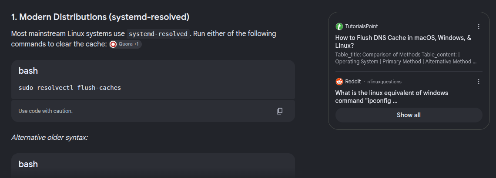

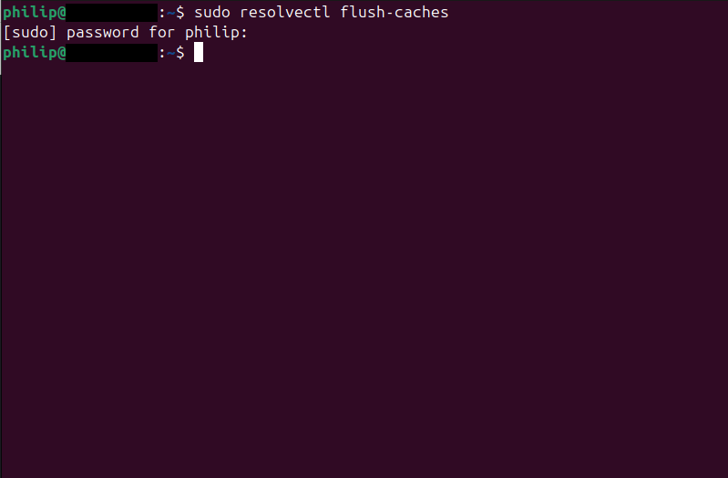

---

## Step 2. Start the Wireshark Capture

I opened Wireshark (version 4.2.2) and hovered over the Wi-Fi interface `wlp2s0` to check which addresses it had. Then I double-clicked it to start capturing.

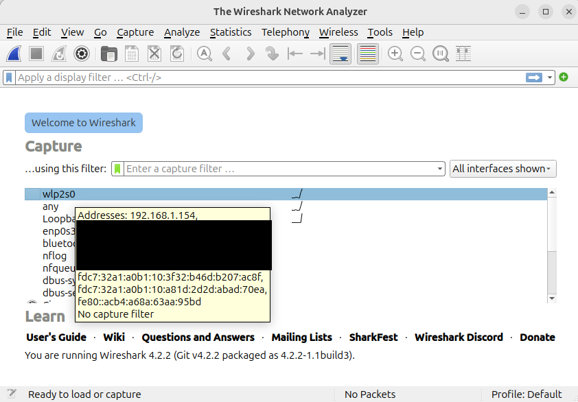

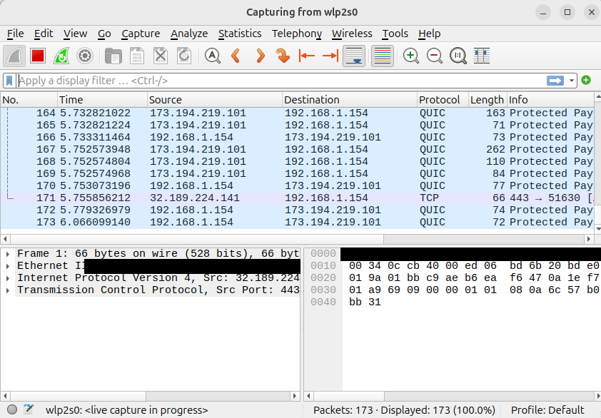

---

## Step 3. Visit the Website and Stop the Capture

With the capture running, I opened a new **Incognito** window in Chrome and loaded `https://networkwalks.com`. Once the page loaded fully, I went back to Wireshark and stopped the capture.

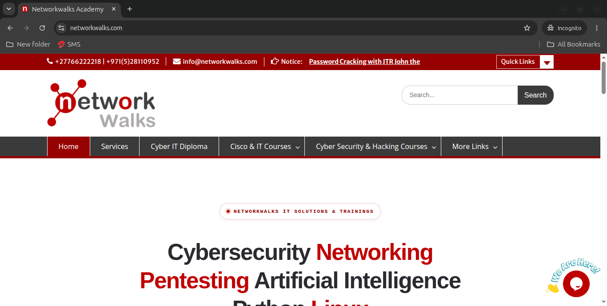

---

## Step 4. Filter for DNS Traffic (First Attempt)

I applied this display filter to find the DNS lookup:

```text
dns.qry.name == "networkwalks.com"
```

The filter worked, but every packet showed **IPv6 addresses** instead of IPv4. The DNS answer still contained the website's IPv4 address (`192.232.216.135`), but the laptop and DNS server addresses were IPv6, which did not match what the lab asks for.

I troubleshot this and fixed it in Step 5 (details in *Problems Encountered*).

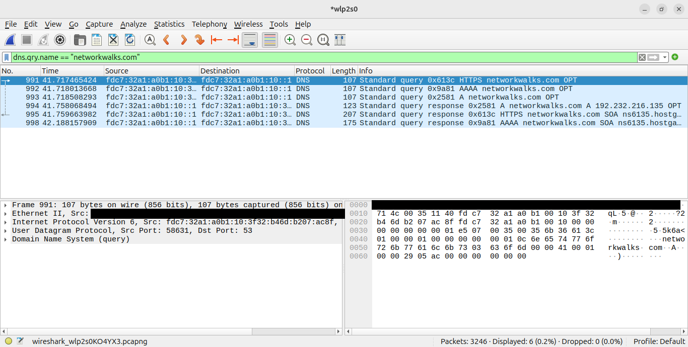

---

## Step 5. Repeat the Capture on a Different Network and Re-filter DNS

After reconnecting to another network and repeating the capture, the same filter returned IPv4 addresses:

```text
dns.qry.name == "networkwalks.com"
```

- **Source** of the DNS query (my laptop): `10.108.56.17`
- **Destination** of the DNS query (my DNS server): `10.108.56.161`
- **Answer** in the DNS response: `networkwalks.com` has IP address `192.232.216.135`

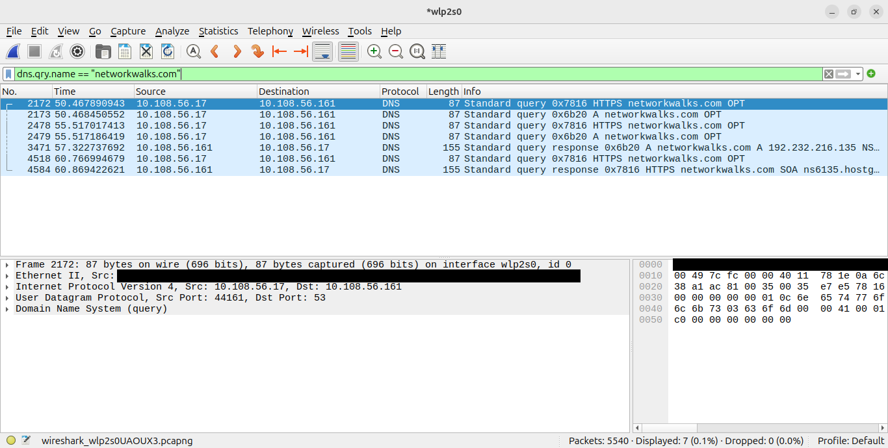

**Observation:** the DNS queries were sent more than once before the answer arrived. The first query went out at about 50.5 seconds and the answer came back at about 57.3 seconds, roughly 7 seconds later. This is a good reminder that a slow DNS server affects how quickly a website opens.

---

## Step 6. Find the Server Name and Port in the TLS Client Hello

I applied this filter to show the first packet of every secure connection:

```text
tls.handshake.type == 1
```

Many Client Hellos appeared (Google services, fonts, and so on), so I picked the one whose destination was the website IP `192.232.216.135` and whose Info column said `SNI=networkwalks.com`.

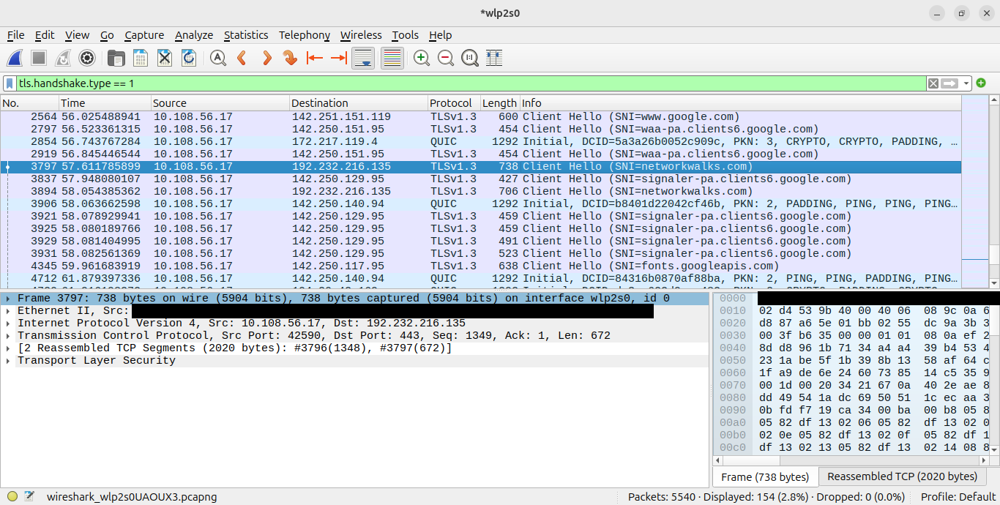

**Server Name:** I expanded *Transport Layer Security → Handshake Protocol: Client Hello → Extension: server_name*. The name sent is `networkwalks.com`.

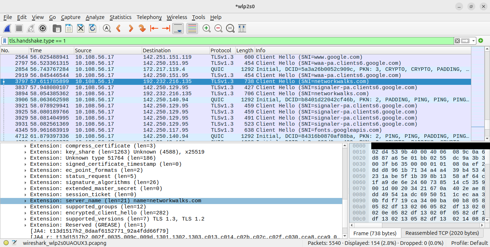

**Server Port:** I expanded the *Transmission Control Protocol* line. The **Destination Port is 443**, the standard port for HTTPS. My laptop used a temporary source port (`42590`) for its side of the connection.

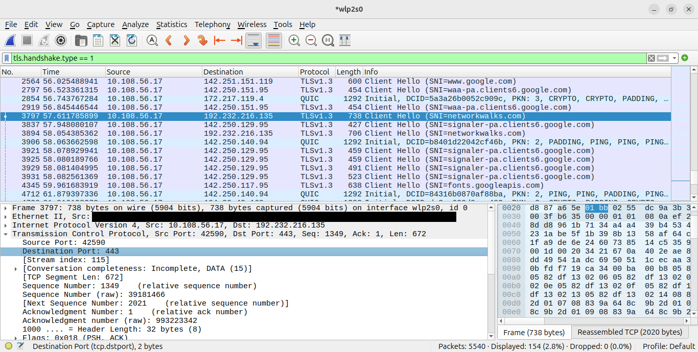

**Observation:** Wireshark reported that this Client Hello was reassembled from two TCP segments (2020 bytes in total), so a single handshake message can be split across several packets.

---

## Step 7. Find the TLS Version in the Server Hello

I applied this filter to show the website's reply:

```text
tls.handshake.type == 2
```

I picked the Server Hello whose **Source** was the website IP `192.232.216.135`. The Protocol column shows **TLSv1.3**.

I also confirmed this was the reply to my connection: the Server Hello is sent from port `443` to my port `42590`, and its acknowledgment number (`2021`) matches the next sequence number of my Client Hello.

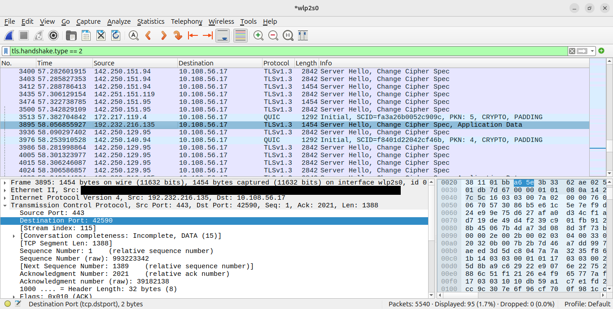

---

# 📊 Results

| # | ❓ Question                                   | ✅ Answer             | 🔎 Where I Found It                                      |
| - | --------------------------------------------- | --------------------- | -------------------------------------------------------- |
| 1 | IP address of my laptop                       | `10.108.56.17`        | Source of the DNS query                                  |
| 2 | IP address of my DNS server                   | `10.108.56.161`       | Destination of the DNS query                             |
| 3 | IP address of `networkwalks.com`              | `192.232.216.135`     | Answer in the DNS response                               |
| 4 | Server Name sent in the TLS Client Hello      | `networkwalks.com`    | Client Hello → Extension: `server_name`                  |
| 5 | Server port for the secure connection         | `443`                 | TCP Destination Port in the Client Hello                 |
| 6 | TLS version the website uses                  | `TLSv1.3`             | Protocol column of the Server Hello                      |

### How the Pieces Fit Together

```text
Laptop (10.108.56.17)
   │
   │ 1. DNS query: "what is the IP of networkwalks.com?"
   ├──────────────────────────────►  DNS server (10.108.56.161)
   │ 2. DNS answer: 192.232.216.135
   │◄──────────────────────────────
   │
   │ 3. TLS Client Hello (SNI = networkwalks.com)
   ├──────────────────────────────►  Website (192.232.216.135, port 443)
   │ 4. TLS Server Hello (TLS 1.3)
   │◄──────────────────────────────
```

---

# 🐞 Problems Encountered & Solutions

### Problem 1: Capture Showed IPv6 Addresses Instead of IPv4
* **Issue:** After applying the DNS filter, the source and destination addresses were IPv6 (starting with `fdc7:32a1:a0b1:10...`) instead of IPv4. The interface did have an IPv4 address (`192.168.1.154`), but the laptop used IPv6 to reach its DNS server.
* **Research:** I searched for why Wireshark was showing IPv6 instead of IPv4. I learned that modern operating systems prefer IPv6 whenever the network offers it, so the DNS queries were sent over IPv6.

  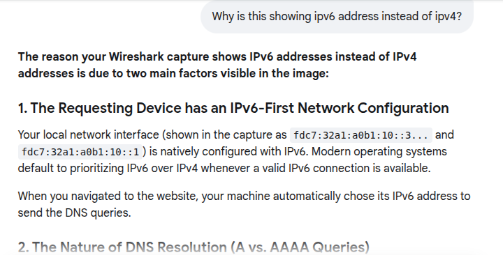

* **Resolution:** I reconnected to a different network and repeated the capture. The DNS queries and replies then used IPv4, and I could read the laptop IP and DNS server IP in the form the lab asks for.
* **Also noticed:** in the IPv6 capture the browser sent three kinds of DNS query for the same site (A, AAAA and HTTPS). The AAAA query came back with an SOA record instead of an address, which suggests the website has no IPv6 address.

### Problem 2: The Lab Uses a Windows Command
* **Issue:** The lab says to run `ipconfig /flushdns`, which does not exist on Ubuntu.
* **Resolution:** I searched for the Linux equivalent and used `sudo resolvectl flush-caches`.

---

# 💡 Key Learnings

1. **How a website visit starts:** DNS lookup first, then a TCP connection, then a TLS handshake. Reading the packets in that order made the process clear.
2. **Why flushing the DNS cache matters:** without it, the lookup may be skipped and there would be no DNS packets to analyze.
3. **IPv4 vs IPv6:** a network can offer both, and the operating system may choose IPv6 first. Knowing this helped me understand my capture instead of assuming something was broken.
4. **A, AAAA and HTTPS DNS queries:** a browser can ask for IPv4 addresses, IPv6 addresses, and HTTPS service information for the same site.
5. **SNI is visible even with encryption:** the website name appears in the Client Hello before encryption begins, which is useful for network visibility.
6. **Display filters save time:** `dns.qry.name`, `tls.handshake.type == 1` and `tls.handshake.type == 2` turned thousands of packets into a handful I could read.
7. **Verifying a reply belongs to a request:** matching the Server Hello's acknowledgment number to the Client Hello's next sequence number confirmed they were part of the same connection.
8. **Adapting instructions:** I completed a Windows-based lab on Ubuntu by finding the equivalent command and checking that the results matched what the lab expects.

---

# 🔐 Security & Ethical Use

This lab is for education only. I captured traffic from my own laptop's Wi-Fi interface and visited a public website. Packet capture should only be performed on networks and devices you own or have permission to monitor.

---

# 🔗 Tools & Resources

- **Wireshark:** [https://www.wireshark.org/download.html](https://www.wireshark.org/download.html)
- **NetworkWalks:** [https://networkwalks.com](https://networkwalks.com)

---

# 👤 Author

**Philip Ajik**  
Cybersecurity Student (Batch B082) — Networkwalks Academy  
LinkedIn: [https://www.linkedin.com/in/philip-ajik-a22944384](https://www.linkedin.com/in/philip-ajik-a22944384)

---

## 📌 Project Information

**Program Name:** Cybersecurity at Networkwalks | **Week:** 01 | **Project:** Wireshark Packet Capture | **Repository:** GitHub
